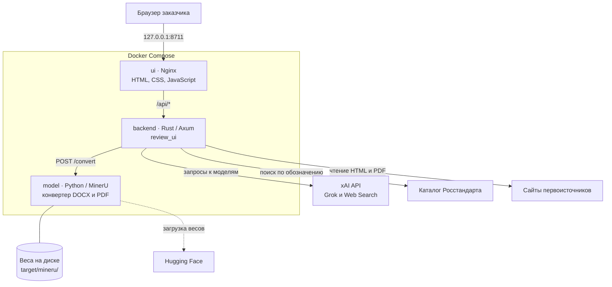
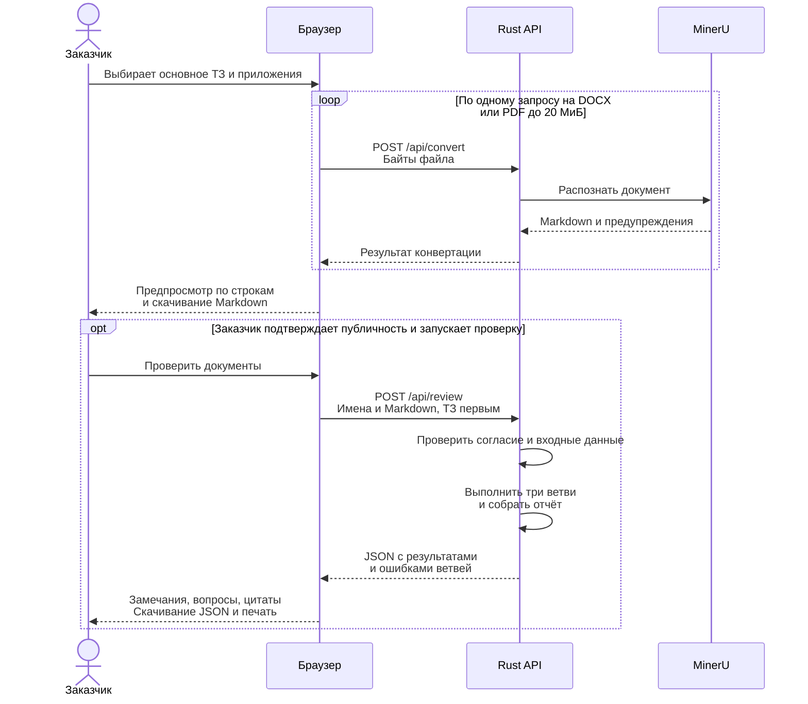
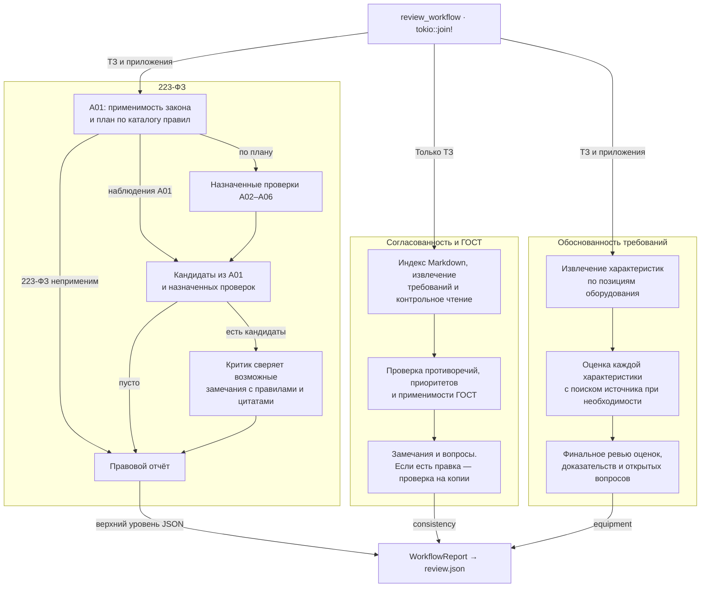
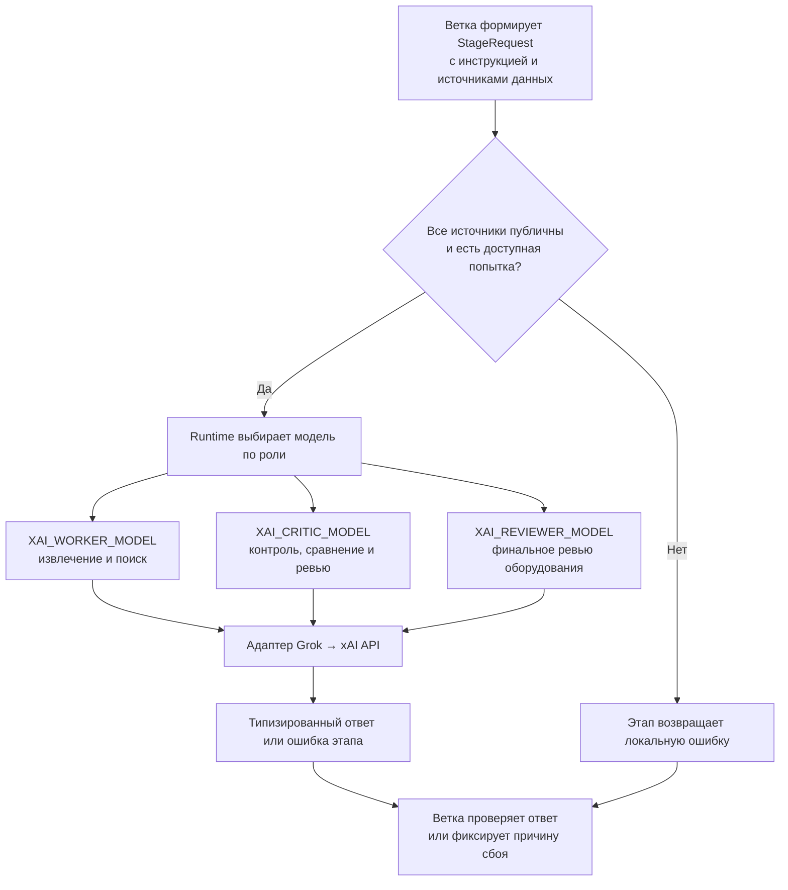

# mipt-ai-agents-hackathon

Сервис проверяет техническое задание (ТЗ) на закупку и его приложения. Заказчик загружает DOCX или PDF, сверяет распознанный текст и получает отчёт с замечаниями, цитатами из документов и вопросами для уточнения требований.

## Запуск через Docker Compose

Нужны Docker Engine в режиме Linux-контейнеров, Docker Compose с поддержкой `up --wait` и браузер. Rust, Python и Poppler входят в образы. Конвертация работает на CPU. Для первой сборки и загрузки весов нужен интернет. Веса MinerU Basic (ONNX) занимают около 0,84 ГиБ в `target/mineru/` и используются при следующих запусках.

Если Docker ещё не настроен, сначала запустите `./scripts/deploy-model.sh`. Скрипт запускает Docker и развёртывает сервис распознавания. На macOS он поддерживает Docker Desktop и выбранный OrbStack, для установки Docker Desktop использует Homebrew. На Ubuntu и Debian он устанавливает Docker из репозитория Docker, на Fedora — из системных пакетов. На Windows запускайте скрипт из Git Bash с WSL 2 и включённой виртуализацией. Для установки Docker Desktop скрипт использует WinGet. На Linux установка может запросить `sudo`. Если сокет Docker доступен только root, последующие команды Compose тоже потребуют `sudo`.

Из корня проекта соберите и запустите все три сервиса.

```sh
docker compose up -d --build --wait
docker compose ps
```

Откройте интерфейс по адресу [http://127.0.0.1:8711/](http://127.0.0.1:8711/). Для проверки запуска загрузите [пример паспорта](tests/fixtures/qualification/passport.pdf) и нажмите «Подготовить документы». В предпросмотре появятся `Bandwidth MHz` и значения `50` и `100`. Этот шаг работает без API-ключа. Для анализа публичного ТЗ задайте `XAI_API_KEY`, как описано ниже.

Если первый запуск занимает время, ход загрузки весов покажет `docker compose logs --tail=50 model`. Чтобы остановить приложение, выполните `docker compose down`. Скачанные веса сохранятся в `target/mineru/`.

Тест конвертации таблицы DOCX и встроенного изображения можно выполнить в запущенном контейнере.

```sh
docker compose exec -T model env PYTHONPATH=/app python - < scripts/test_docx_markdown.py
```

## Настройки и внешние сервисы

Compose читает настройки из окружения или из файла `.env` рядом с `compose.yaml`. Для проверки через Grok добавьте в этот файл строку `XAI_API_KEY=ваш_ключ` и примените изменения командой `docker compose up -d`. При прямом запуске через Cargo сервер читает из `.env` только `XAI_API_KEY`. Другие настройки передайте через `export` перед запуском.

| Переменная | По умолчанию | Назначение |
| --- | --- | --- |
| `UI_PORT` | `8711` | Порт интерфейса на `127.0.0.1` в Compose. |
| `XAI_API_KEY` | Пусто | Серверный ключ xAI для анализа публичных документов. |
| `XAI_WORKER_MODEL` | `grok-4.20-0309-non-reasoning` | Модель для извлечения требований и поиска источников. |
| `XAI_CRITIC_MODEL` | `grok-4.20-0309-reasoning` | Модель для проверки выводов. |
| `XAI_REVIEWER_MODEL` | Значение `XAI_CRITIC_MODEL` | Отдельная модель финального ревью требований к оборудованию. |
| `TZ_REVIEW_BUDGET` | `7` | Бюджет попыток вызова модели в одной проверке по 223-ФЗ. |
| `REVIEW_BIND` | `127.0.0.1:8710` при прямом запуске | Адрес Rust-сервера. Compose задаёт `0.0.0.0:8710` внутри контейнера. |
| `DOCX_MODEL_URL` | Локальный Python-процесс при прямом запуске | Адрес HTTP-конвертера DOCX и PDF. Compose задаёт `http://model:8000/convert`. |
| `MINERU_HOME` | `/models` в контейнере | Каталог весов. При прямом запуске укажите путь, использованный при загрузке весов. |

| Внешний сервис | Когда и для чего используется |
| --- | --- |
| Docker Hub, репозитории Debian, crates.io и PyPI | При сборке поставляют базовые образы, системные пакеты, зависимости Rust и Python. |
| Hugging Face | При первом запуске или отсутствии весов сервис `model` загружает MinerU Basic. Затем документы распознаются локально. |
| xAI API (`api.x.ai`), включая Web Search | После подтверждения публичности сервер отправляет модели текст для проверки. При оценке оборудования модель может искать технические первоисточники. |
| Каталог Росстандарта (`protect.gost.ru`) | Ветка согласованности запрашивает карточки упомянутых ГОСТ по их обозначениям. |
| Публичные HTTPS-сайты первоисточников | Ветка оборудования открывает найденные документы, например паспорт производителя, и извлекает подтверждение характеристики. |

## Запуск без Docker

Для macOS и Linux нужны Rust с Cargo (в Docker используется Rust 1.99), системный линкер, `uv` и Python 3.11 для конвертера. Версии зависимостей Rust закреплены в [Cargo.lock](Cargo.lock), версия MinerU — в [зависимостях конвертера](scripts/docx-requirements.txt). Чтобы ветка оборудования могла читать внешние PDF, установите Poppler с командой `pdftotext` в `PATH`.

```sh
uv venv --python 3.11 target/mineru-env
uv pip install --python target/mineru-env/bin/python -r scripts/docx-requirements.txt
export MINERU_HOME="$PWD/target/mineru"
target/mineru-env/bin/mineru-kit models download --tier basic --small-backend onnx --source huggingface
cargo run --locked --bin review_ui
```

Интерфейс доступен по адресу [http://127.0.0.1:8710/](http://127.0.0.1:8710/). Чтобы остановить сервер, нажмите `Ctrl+C` в терминале, где запустили Cargo.

## Архитектура и поток данных

### Сервисы и сетевые соединения



Compose публикует на хосте только порт Nginx. При запуске через Cargo браузер обращается напрямую к `review_ui` на `127.0.0.1:8710`. В этом режиме Axum раздаёт тот же интерфейс, а для конвертации запускает `scripts/docx_markdown.py` как дочерний процесс, если `DOCX_MODEL_URL` не задан. [Конфигурация Compose](compose.yaml) · [Маршруты сервера](src/bin/review_ui.rs)

### От загрузки до отчёта



MinerU Flash извлекает текст и таблицы DOCX и текстовые страницы PDF. Для встроенных изображений DOCX и страниц PDF с изображениями или без текста конвертер использует MinerU Basic. Заказчик может проверить распознанные числа и единицы измерения до передачи текста в xAI. [Конвертер](scripts/docx_markdown.py) · [Логика интерфейса](ui/app.js)

### Три параллельные ветви проверки



Каждая ветвь возвращает собственный результат. Если одна завершилась ошибкой, сервер сохраняет её причину в `branch_error` и включает в ответ результаты остальных. В интерфейсе можно перейти от замечания к строкам документа, на которые оно опирается. [Проверка по 223-ФЗ](src/runtime/tz_review/mod.rs) · [Согласованность и ГОСТ](src/consistency/mod.rs) · [Оценка оборудования](src/qualification/mod.rs)

### Как ветви вызывают модели



У каждой ветви свой `ReviewRun` с бюджетом попыток. Повторный вызов расходует попытку из того же бюджета. Для финального ревью оборудования по умолчанию используется модель критика. Веб-поиск возвращает адреса возможных источников, затем ветвь оборудования сама читает первоисточник и проверяет, подтверждает ли он характеристику. [Вызов этапов](src/runtime/stage.rs) · [Поиск](src/runtime/search.rs) · [Чтение источников](src/qualification/sources.rs)

## Типовые сценарии

Оба примера запускаются из корня проекта без ключа xAI и печатают JSON. Ответы моделей для них заданы заранее. При первой сборке Cargo скачает зависимости.

### Найти противоречие перед публикацией ТЗ

В одном абзаце заказчик указал, что лифт А должен иметь массу «ровно 300 кг при работе», в другом — «ровно 500 кг при работе». [Исходное ТЗ](tests/fixtures/consistency/demo/paragraphs.md)

```sh
cargo run --locked --example review_markdown
```

**Ожидаемый результат.** В `initial.investigations` есть подтверждённое противоречие (`Confirmed`) с цитатами из обоих абзацев. В `initial.selections` появляется `AskUser` с двумя вариантами. Заказчику нужно выбрать, какую массу указать в ТЗ.

### Проверить, хватает ли точности лабораторных весов

Исходное ТЗ допускает шаг до 0,1 г, исправленное — до 0,01 г. На вопрос о задаче измерения заказчик отвечает, что нужно различать изменения массы 0,02 г. Пример передаёт этот ответ через API библиотеки для каждой редакции. [Исходная редакция](examples/fixtures/qualification/original.md) · [Исправленная редакция](examples/fixtures/qualification/revised.md)

```sh
cargo run --locked --example equipment_adequacy
```

**Ожидаемый результат.** До ответа оценка шага ожидает уточнения (`pending`). После ответа в `original.after` требование к шагу оценено как недостаточное (`insufficient`), а в `revised.after` — как обоснованное (`justified`).

## Проверка обоснованности требований к оборудованию

```sh
cargo run --offline --locked --example equipment_adequacy
```

Пример без ключа воспроизводит два независимых синтетических Markdown-входа по сценариям исходной и исправленной редакций метрологического ТЗ. Записанные ответы исполнителя, поиска и ревьюера лежат в `examples/fixtures/qualification/`. Пример читает локальный снимок паспорта и выводит JSON до и после адресного ответа заказчика. Исходная редакция допускает шаг 0,1 г, исправленная — 0,01 г; ответ о необходимости различать 0,02 г даёт разные оценки. У памяти прибора остаётся свой вопрос о максимальной серии до выгрузки. Это проверка исполнения сценария; качество настоящей модели требует отдельной оценки на размеченных документах.

Для живого запуска задайте `XAI_API_KEY`, `XAI_WORKER_MODEL` и `XAI_REVIEWER_MODEL`. Последняя переменная выбирает отдельно настроенную более сильную модель финального ревью. Режим `--live-public` задаёт статус `Public` всем перечисленным файлам.

```sh
cargo run --offline --locked --example equipment_adequacy -- --live-public specification.md passport.pdf method.html > qualification.json
```

Флаг Cargo `--offline` относится к зависимостям сборки; режим `--live-public` обращается к xAI и первоисточникам. ТЗ и вложения поддерживают Markdown, HTML и PDF. Чтение PDF требует Poppler с командой `pdftotext` в `PATH`; отсутствие команды, скан без текста или ненадёжная таблица дают частичный отчёт. DOCX конвертирует вызывающее приложение.

Публичный API находится в `procurement_review::qualification`:

- `review_equipment_adequacy(input, options, worker, reviewer, sources)` выполняет первый обход и одно финальное ревью.
- `resume_equipment_adequacy(input, saved_report, answer, options, worker, sources)` проверяет исходный комплект и продолжает одно требование без повторного извлечения и финального ревью.
- `QualificationReport::questions()` возвращает текущие открытые вопросы; `coverage.complete()` учитывает обработку исходных блоков, финальное ревью и пропуски.

Отчёт сериализуется через Serde. Для продолжения сохраните его и повторно передайте исходное ТЗ и все первоначальные вложения. `Clarification` содержит ID вопроса и требования, версию ТЗ, текст и видимость ответа. Подмена версии, неполный комплект, изменение исходной видимости или закрытый вопрос возвращают прежний отчёт и причину до внешних обращений.

При техническом сбое переоценки неотвеченный вопрос сохраняет ID и остаётся доступен для ответа; ошибка записывается в пробелы покрытия. Если локальная сверка правок ревьюера не прошла, весь пакет правок откатывается с сохранением прежних требований и вопросов.

Адрес Markdown — диапазон байтов UTF-8 исходной версии. Для HTML/PDF `SourceRef` дополнительно указывает версию текстового представления; PDF сохраняет страницу. Прочитанные блоки доступны в отчёте, поэтому цитату можно проверить и после восстановления. Сложная геометрия HTML-таблицы, включая объединённые ячейки, отмечается как пробел покрытия.

Текстовые стадии, поиск и ревью разделяют `ReviewRun`. Для финального ревью сценарий оставляет одну попытку; адресная обработка его замечаний использует остаток. HTTP-загрузки имеют отдельный бюджет. `PublicHttp` проверяет публичные HTTPS-адреса и DNS, отключает скрытые повторы и автоматические переадресации. `SnapshotHttp` воспроизводит чтение без сети. `searches` хранит кандидатов и статистику инструментов, `facts` — отдельно подтверждённые по оригиналу значения. Контракты xAI: [Web Search](https://docs.x.ai/developers/tools/web-search), [Citations](https://docs.x.ai/developers/tools/citations).

Извлечение передаёт ограниченные пакеты с учётом схемы ответа. Для проверки отсылок каждый пакет приложения сопоставляется с пакетами ТЗ в пределах общего бюджета. Оценка требования и единственное финальное ревью используют полный контекст; превышение их лимита явно отмечается как частичное покрытие.

```sh
cargo test --offline --locked
openspec validate add-equipment-adequacy-review --strict --no-interactive
```

## Проверка согласованности Markdown

```sh
cargo run --locked --offline --example review_markdown
```

Пример печатает JSON в stdout, журнал этапов — в stderr. Он использует локальные ответы модели, синтетическое ТЗ и датированный снимок каталога. В выводе можно открыть цитаты обеих сторон, увидеть вопрос заказчику и проверить результат исправления копии. Дополнительные случаи демонстрируют работу критика с оговоркой, вопрос о чертеже и выбор по правилу приоритета.

В Rust вызовите `consistency::review_markdown(&document, options, &runtime, &catalog)`. Для официального поиска используется `review_with_catalog` с ограниченной сессией `CatalogHttp`. Отчёт сохраняет по каждому блоку исход извлечения и контрольного чтения, по каждому расследованию — доказательства и решение или причину остановки. Повтор на копии расходует остаток того же бюджета.

Для сравнения полного сценария, прямого запроса и сценария без дочитывания запустите команду из корня проекта. Укажите новый каталог вывода. Режим `offline` проверяет запуск и формат отчётов.

```sh
cargo run --locked --offline --example benchmark_markdown -- lift offline 32 /tmp/lift-benchmark
```

Для живого эксперимента укажите ключ `XAI_API_KEY` в окружении или файле `.env` в корне проекта. Например:

```sh
cargo run --locked --offline --example benchmark_markdown -- lift grok-4.20-0309-non-reasoning 32 /tmp/lift-live --review-model grok-4.20-0309-reasoning
```

В штатном живом прогоне `MODEL` выполняет первичное извлечение. Проверочная модель выполняет контрольное чтение, семантическое сравнение, поиск связей между утверждениями, оценку ГОСТ, расследование кандидатов, выбор приоритета и прямой запрос. По умолчанию для этой роли используется `grok-4.20-0309-reasoning`. Для воспроизведения однородной серии укажите тот же идентификатор в `--review-model`. Каталог, выдача затребованного блока и объединение результатов работают локально. Режим `offline` внутри примера использует тестовые ответы для обеих ролей. Флаг Cargo `--offline` относится к загрузке зависимостей. Три тестовых входа — `lift`, `metrology` и `held-out-water`. После ручного сопоставления идентификаторов замечаний с эталоном запустите `compare_consistency`. [Эталонные цитаты и решения](tests/fixtures/consistency/GOLD.md)

Если документ предназначен для отправки внешнему провайдеру, явно укажите его Markdown-файл:

```sh
cargo run --locked --example benchmark_markdown -- --public-markdown /path/to/public.md MODEL 32 /tmp/public-benchmark
```

Для переданного файла запускается `full` с пакетом 8 192 байта и тайм-аутом 120 секунд. Для каждого режима пример сохраняет полученный текст ответа, ошибку или отмену в `*.responses.jsonl`. Каждая запись содержит номер попытки, этап, роль и фактическую модель. Для вызовов критика указан идентификатор кандидата. Журнал `events.jsonl` и stderr содержат отправку, длительность и исход, включая тайм-ауты и локальные остановки до вызова API. Отчёт хранит запрошенные блоки, решение по чтению и приведённые доказательства. В трассах ответов могут встречаться фрагменты исходного документа.

Все три режима эксперимента используют один снимок каталога. При живом запуске файл `catalog-comparison.json` отдельно фиксирует отличия от официального каталога на дату обращения. Чтобы проверить применимость ГОСТ по свежим карточкам Росстандарта, добавьте `--live-catalog` к живому запуску с `--public-markdown`. Полученная карточка используется для каждого упоминания стандарта. Адреса и результаты запросов сохраняются в `catalog-comparison.json` и `full.json`.

Чтобы измерить расход, задайте переменную окружения `XAI_RECORD_USAGE=1` перед запуском `benchmark_markdown`. По умолчанию учёт выключен. В `*.responses.jsonl` и `*.metadata.json` полученная от xAI статистика привязана к попытке, узлу, роли и модели. Учитываются входные, кэшированные, выходные и reasoning-токены, а также стоимость, когда её вернул провайдер. Для тайм-аута без ответа стоимость неизвестна. Ключ кэша строится из SHA-256 исходного Markdown, а общие инструкции узла передаются перед меняющимися данными пакета.

## Типизированные этапы

```sh
cargo run --example typed_stage
```

Пример работает без сети и ключа: два вызова `Runtime::step` используют общий `ReviewRun::new(2)`. Первый возвращает доказательство, второй — заключение с неверным ID. JSON при этом соответствует ожидаемому типу, поэтому программа сама проверяет ID, отклоняет заключение и сохраняет первое доказательство. Библиотека проверяет форму ответа при десериализации, но предметную корректность полей проверяет вызывающий код.

В `StageRequest::new` передавайте доверенную, заданную приложением инструкцию. Документ, уточнения и другие внешние данные добавляйте через `field(name, &[Visibility], &value)`, а не в инструкцию. Для каждого поля указывайте статусы **всех** его источников: в том числе поздних уточнений и материалов, из которых получено производное значение. Статус исходного документа не делает производную сводку публичной автоматически. Перед каждым шагом runtime отклоняет поле с пустым списком источников, `Private` или `Unknown` до отправки.

`ReviewRun` ограничивает общее число попыток для его этапов; `attempts()` показывает число переданных модели запросов. Отказ по контексту (`StepError::RestrictedContext`), ошибка сериализации (`Preparation`) и исчерпанный бюджет (`BudgetExhausted`) не расходуют попытку. После отправки тайм-аут, ограничение частоты, ошибка провайдера или неверный формат возвращаются как `StepError::Model` с соответствующей `ErrorCategory` и расходуют одну попытку; автоматического повтора нет. Обрабатывайте причины отдельно и сохраняйте ранее полученные результаты, если следующий этап завершился ошибкой.

## Локальный пример проверки 223-ФЗ

```sh
cargo run --example review_223
```

Пример не требует API-ключа и не выполняет сетевых запросов. Локальные ответы моделируют находку в документе и HTTP 429 для соседней проверки. Затем пример показывает заключение критика и тайм-аут критика. В обоих случаях доступны находка, ссылки на оба фрагмента документа и ошибка проверки.

## Как добавить проверку

Добавьте в список `Check` со стабильным `id`, инструкцией в `prompt` и дополнительными материалами в `materials`. Данные ТЗ передавайте через `Document`. Инструкции проверок должны быть пригодны для отправки провайдеру. Пример возвращает ссылки на цитаты в виде байтовых диапазонов UTF-8 исходного Markdown, где конец диапазона исключается.

Сценарий можно записать обычной `async fn`. Она может собрать и вернуть отчет следующим образом.

```rust
let outcomes = agents.run_parallel(document, checks).await?;
let evidence = aggregate(document, outcomes);
let report = match critic.review(document, &evidence, &[]).await {
    Ok(verdict) => BranchReport::Reviewed { evidence, verdict },
    Err(error) => BranchReport::CriticFailed { evidence, error },
};
```

Для готовой ветки используйте `runtime::scenario::review_223`. Она связывает события этапов общим `run_id` и по умолчанию пишет JSON-журнал в stderr. Пустой список находок означает, что проверка выполнилась успешно. Отдельный сбой виден по ID проверки в `evidence.outcomes`.

## Подключение Grok

Задайте `XAI_API_KEY` в окружении или в файле `.env` рабочего каталога. Переменная окружения имеет приоритет. В примере первичное извлечение использует non-reasoning модель, а контроль, сравнение и проверка используют reasoning-модель.

```rust
use std::time::Duration;
use procurement_review::runtime::{grok::Grok, Runtime};

fn grok_runtime() -> Result<Runtime<Grok>, &'static str> {
    let worker = Grok::from_env("grok-4.20-0309-non-reasoning".into())?;
    let reviewer = Grok::from_env("grok-4.20-0309-reasoning".into())?;
    Ok(Runtime::new(worker, Duration::from_secs(60)).with_reviewer(reviewer))
}
```

`StageRequest::schema` передаёт JSON Schema в xAI при запросах структурированных ответов. Для записи событий в файл и stderr вызовите `runtime::logging::init_with_file(file)` до запуска. Журнал типизированных этапов сохраняет роль, запуск, попытку и исход. Для статистики полученных ответов доступен `Grok::with_usage_recording`.

`review_223` принимает отдельные `Runtime` для проверок и критика. Перед внешней отправкой документ и все материалы проверок должны иметь статус `Visibility::Public`.

## Запуск набора проверок через xAI

Пример `workflow_223` загружает `223fz_27_agents_ru_unified.json` и `ТЗ_замена_грузового_лифта.md` из текущего каталога. Он отправляет ТЗ и инструкции в xAI: запускает A01 первой, затем остальные проверки параллельно и передаёт результаты критику. Результат выводится в JSON, ошибки отдельных проверок сохраняются в отчёте. Результат A01 пока не управляет запуском остальных проверок; применимость закона необходимо установить отдельно. Пустые ссылки у цитаты означают, что точное совпадение в ТЗ не найдено.

Установите Rust и выполните из корня проекта. Модели ниже используются по умолчанию; при необходимости замените их на доступные в вашем аккаунте:

```sh
export XAI_API_KEY='ваш ключ'
export XAI_WORKER_MODEL='grok-4.20-0309-non-reasoning'
export XAI_CRITIC_MODEL='grok-4.20-0309-reasoning'
cargo run --example workflow_223 > report.json
```

Не публикуйте ключ или отчёт, если он содержит непубличные данные. Проверки выполняются по предоставленной в JSON редакции законодательства, актуальность которой нужно проверить на дату закупки. Анализ модели требует проверки специалистом.

## Диагностика ошибок запросов

У ошибочной проверки в `evidence.outcomes` теперь есть поле `diagnostic`: `category`, `stage`, `reason` и, если доступен, `http_status`. Этап `provider` означает ошибку транспорта или обработки ответа SDK; `response_validation` — незавершённый ответ, вызов инструмента или отказ; `response_text` — отсутствие текста; `json_decode` — ошибка синтаксиса или структуры JSON; `timeout` — превышение времени запроса. Для JSON указываются класс ошибки, строка, столбец, ожидаемый тип и размер ответа. Исходные ответы, инструкции и ключи в диагностике не сохраняются. Старые отчёты читаются без поля `diagnostic`.

`Runtime::request_json_detailed` возвращает `RequestError`. Пользовательские модели могут переопределить `Model::complete_detailed`; существующие реализации `complete` продолжают работать. Ошибки критика и типизированных этапов подробно записываются в stderr; прежние категории ошибок API сохранены. При создании `CheckOutcome` в Rust теперь нужно указать `diagnostic: None`, если подробностей нет.

Для сохранения журнала отдельно от отчёта:

```sh
cargo run --example workflow_223 > report-new.json 2> workflow.log
```

Старые `InvalidResponse` невозможно уточнить задним числом: для диагностики потребуется новый запуск.

Для проверки одного агента без запуска критика задайте его ID, например:

```sh
CHECK_ID=A03 cargo run --example workflow_223 > report-one.json 2> workflow-one.log
```

Для статистики токенов в stderr задайте `XAI_RECORD_USAGE=1`; по умолчанию учёт выключен. Допустимые значения — `0` и `1`. Для запросов используется ключ кеширования SHA-256 исходного текста ТЗ; попадание в кеш зависит от провайдера.

Для полного запуска уберите `CHECK_ID`. Ответ в единственном блоке Markdown с меткой `json` или без метки принимается как JSON; произвольный текст вокруг блока отклоняется. Найденные цитаты по-прежнему нужно проверять по ссылкам: пустой `links` означает, что цитата не найдена в исходном документе.

## Проверка по 223-ФЗ с отдельным списком замечаний

Из корня проекта передайте путь к публичному ТЗ в Markdown и имя нового каталога результатов. Ключ xAI читается из `XAI_API_KEY` или локального `.env`.

```sh
cargo run --locked --example tz_review -- --public ТЗ_замена_грузового_лифта.md lift-review
cargo run --locked --example tz_review -- --public принтер.md printer-review
```

После каталога можно передать пути к публичным Markdown-приложениям. Флаг `--public` подтверждает возможность внешней отправки ТЗ и всех переданных CLI приложений. Библиотечный вход `runtime::tz_review::review` принимает статус каждого документа отдельно. Чтение пустого файла или невалидного UTF-8 завершается до вызова модели.

Откройте `remarks.md` в просмотрщике Markdown. В нём все опубликованные замечания отсортированы по строкам. Ссылка ведёт к подсвеченной строке в `source.html` — автономной копии именно той редакции, которую читала модель. Рядом лежит побайтная копия `source.md`. `report.json` содержит путь к оригиналу, SHA-256 его байтов, решение A01, план, проверяемые цитаты и смещения UTF-8, решения и ошибки по этапам, модели, фактический расход и бюджет. Файл ТЗ используется только для чтения.

A01 оценивает применимость закона и составляет план A02–A06. Области одной проверки передаются вместе; общий бюджет по умолчанию — семь запросов (план, до пяти проверок, критик). Критик принимает отдельное решение по каждому кандидату. Подтверждённое замечание может иметь предложенную формулировку. При конкретном риске и недостатке материалов выводится «требует проверки». Если критик пропустил запись, она учитывается в техническом покрытии. Внешняя нормативная база автоматически не обновляется: в отчёте сохранена редакция каталога.

Настройки: `XAI_WORKER_MODEL`, `XAI_CRITIC_MODEL` и `TZ_REVIEW_BUDGET`. Модели по умолчанию — `grok-4.20-0309-non-reasoning` и `grok-4.20-0309-reasoning`. Ветку можно выполнить без доступа к xAI на подставной модели командой `cargo test --locked --test tz_review`.

В `report.plan` переданы позиции, номера строк `lines` и общие условия `context`. В `report.positions` поле `id` указывает индекс назначения в плане (с нуля). Статус `reviewed` означает, что исполнитель явно вернул этот индекс. Статусы `unacknowledged`, `failed` и `not_dispatched` показывают соответственно отсутствие отметки, ошибку вызова и пропуск до отправки. В `report.decisions` сохраняются исходные и проверенные критиком адреса и причина исправления. Читатель видит установленный факт, все опорные строки и общие условия в `remarks.md`.

Пронумерованный Markdown передаётся один раз в начале каждого запроса. Ключ кэша привязан к SHA-256 входа. Планировщик получает условия выбора проверок и полное правило A01, исполнитель — назначенное правило, критик — по одной копии каждого нужного правила и приложения. В `checks_usage` и `critic_usage` учитываются вызовы и фактические токены. `cached_input_tokens` входят в `input_tokens`. При сравнении расхода учитывайте число вызовов и объём ответа критика.

Перед публикацией A06 сверяет коммерческий идентификатор с явным полем в строке позиции или обозначением зарегистрированной марки. При неточной цитате восстановление допускается только из именованного поля той же строки назначения, когда значение упомянуто в самом кандидате. Для A03 автоматическая публикация охватывает прямо процитированные условия исключительности. Это консервативный охват: неявное ограничение по совокупности технических требований и неразмеченная коммерческая модель могут быть пропущены. Решение о снятии кандидата видно в покрытии.

Для полного диагностического прогона укажите `--public --full` перед путём к Markdown. При применимом или неопределённом режиме выполнение включает план A01, пять проверок A02–A06 и один вызов критика, даже при пустом списке кандидатов. Бюджет должен покрывать семь попыток. При установленной неприменимости правовые проверки пропускаются. В полном режиме `report.stage_log` содержит ответы этапов, ID назначений, входные кандидаты и результат критика. Журнал stdout/stderr можно сохранить рядом с `report.json` перенаправлением вывода.
