# Как проверять требования к оборудованию

## Context

Сценарий отвечает на вопрос «почему для этой операции нужен именно такой параметр?». Один документ может последовательно требовать память твердомера на 1000 измерений и всё же оставлять неясным, сколько записей лаборатория хранит до выгрузки. Вопросы внутренней согласованности текста и применимости нормативных ссылок уже описаны в [соседнем изменении](../add-markdown-consistency-review/proposal.md). Предмет этой ветки определяют [предложение](proposal.md) и [критерии приёмки](specs/equipment-adequacy-review/spec.md).

Библиотека уже принимает Markdown с признаком видимости, хранит цитаты и смещения UTF-8. `Runtime::step<T>` готовит проверенный запрос, резервирует попытку в `ReviewRun` и разбирает ответ. `Grok::complete` возвращает текст. Чтобы найти документ по результату поиска, поисковому режиму понадобится URL из аннотации провайдера. Код `review_223` уже принимает отдельные runtime для исполнителя и критика. [Типы документа](../../../src/core.rs) · [Типизированная стадия](../../../src/runtime/stage.rs) · [Адаптер Grok](../../../src/runtime/grok.rs) · [Сценарий с критиком](../../../src/runtime/scenario.rs)

## Goals / Non-Goals

Единица проверки — одно техническое требование к позиции или её компоненту в известной редакции ТЗ. Вход включает один Markdown, доступные приложения и их происхождение. Выход содержит результаты по требованиям, открытые вопросы и сведения о пропущенных фрагментах. Конвертацией DOCX, показом вопросов, хранением отчёта между обращениями и внесением утверждённых правок управляет вызывающее приложение.

## Decisions

### Обход требований и финальная проверка

Внешний цикл записывает результат по каждому требованию и переходит к следующему даже при открытом вопросе. После обхода, в том числе при пустом списке, запускается финальная сверка. Адресный разбор замечаний заканчивается выдачей отчёта. [Исходник Mermaid](equipment-adequacy.mmd) · [Версия PNG](equipment-adequacy.png)

При уточнении задачи заказчика агент сначала ищет ответ в ТЗ и приложениях. Для весов ему нужна минимальная различимая разница масс, для твердомера — максимальное число записей до выгрузки с учётом повторов. Ветка технического факта работает с самим паспортом или методикой. [Исходник Mermaid](requirement-review.mmd) · [Версия PNG](requirement-review.png)

### Внешний цикл и адреса требований

1. До извлечения сохранить адреса, текст и заголовки исходных абзацев, пунктов и строк таблиц ТЗ и приложений. Сохранять и те блоки, из которых извлечение вернёт ноль записей.
2. Для каждого условия установить, где заказчик сделал его обязательным для данной позиции. Основанием служит формулировка ТЗ или обязательного приложения. Если ТЗ отсылает к части приложения, сохранить также адрес этой отсылки и её область действия. Один документ может содержать и обязательную строку, и справочные столбцы. Паспортные данные и описание задачи остаются доступны для оценки и ревью. Сами по себе они не создают закупочных требований. При неясной области действия указать спорный фрагмент и частичное покрытие.
3. Выделить по одной записи на независимое обязательное условие. Диапазон, его границы и оговорки образуют одно требование. «GigE Vision или USB3 Vision» в позиции № 13 означает одну запись с выбором интерфейса. Привязать цитату к материалу, версии и байтовому диапазону `[start, end)`. Существующий `aggregate` возвращает все совпадения короткой цитаты, поэтому при неоднозначности сверить контекст строки или компонента. Неустановленный адрес отразить в покрытии.
4. Пройти список в порядке документа. Для каждой записи вернуть один текущий исход. Ошибку извлечения указать у исходного блока, даже если записей по нему нет. При исчерпании бюджета у оставшихся известных требований указать причину остановки.

Один вызов проверки на целую позицию скрыл бы ситуацию, когда предел взвешивания обоснован, а для шага показаний ещё нужен ответ. Здесь оба требования сохраняют свою цитату и отдельный исход.

### Внутренний цикл и критерий решения

Сценарий сопоставляет требование с операцией и её режимами. Для «не менее», «не более», диапазона и выбора из нескольких вариантов проверяется то, какие комплектации разрешает ТЗ. Например, «цена деления не более 0,1 г» допускает весы с шагом 0,1 г, даже если выбранная в качестве примера модель имеет шаг 0,01 г. При оценке интерфейса сохраняются обе разрешённые альтернативы.

| Исход | Что получает сотрудник закупок |
| --- | --- |
| Обосновано | Операцию и источник, который объясняет выбранную границу или характеристику. |
| Недостаточно | Пример допускаемой комплектации, конкретную невыполнимую операцию и основания для обоих утверждений. |
| Возможно избыточно | Менее строгую границу, подтверждённые режимы и требуемый запас, который она покрывает. |
| Открытый вопрос | Цитату и один недостающий факт. Например, «Какую разницу масс нужно различать при рабочей нагрузке?» |
| Техническая остановка | Требование или пропущенный блок, стадию и причину. Например, закончились попытки или провайдер вернул 429. |

Модель предлагает оценку или следующий шаг. Сценарий проверяет, что шаг относится к текущему требованию, а вывод опирается на адресованные фрагменты и сопоставимые параметры. Переход на следующую итерацию возможен, когда добавился применимый факт из источника или ответ на конкретный вопрос. Повтор ссылки или того же значения другими словами завершает уточнение при отсутствии иного основания. Отсутствие ответа оставляет вопрос открытым для последующего обращения. Истечение бюджета завершает шаг с техническим исходом.

### Прямое чтение первоисточника

1. Сначала взять приложенный паспорт нужной модели или применимую методику. При отсутствии подходящего материала использовать поисковый режим Grok через `POST /v1/responses` с инструментом `web_search`. Из результатов поиска взять адрес первоисточника, предполагаемое значение и место, где его искать. Аннотация `url_citation` адресует ссылку в ответе Grok. Текст страницы библиотека получает отдельно. [Web Search](https://docs.x.ai/developers/tools/web-search) · [Поля аннотации](https://docs.x.ai/developers/tools/citations)
2. Прочитать приложенный материал либо открыть публичную HTML-страницу или PDF первичного издателя. У HTML сохранить адрес раздела или строки, у PDF — страницу. В обоих случаях сохранить цитату в прочитанной версии. Для таблицы включить заголовки строки и столбца. Сверить модель или редакцию, название характеристики, значение и оговорки, от которых оно зависит. Для величины проверить единицу и границу, когда они применимы. Для качественного свойства проверить точное значение по паспорту. Например, у камеры можно подтвердить глобальный затвор без единицы измерения. У размерной величины с неустановленной единицей значение остаётся неподтверждённым.
3. Передать в оценку проверенный факт с цитатой, идентификатором вложения или конечным URL и местом в документе. Зафиксировать причину, если нужный фрагмент отсутствует, применимость спорна либо текст или таблицу нельзя надёжно прочитать. Недоступный источник и ошибка чтения дают техническую причину, неподтверждённая характеристика остаётся открытой. Уже подтверждённые основания сохраняются.

Текстовые вызовы, поиск и ревью используют один `ReviewRun` и проверку происхождения всех передаваемых полей. Для прямой загрузки отдельно проверяются публичность производного запроса, допустимость публичного адреса и каждого перенаправления. Чтение ограничено по времени и объёму, учитывается отдельно от попыток модели и воспроизводится на локальном снимке. Вложения и страницы передаются как данные. Запрет отправки, 429, тайм-аут и незавершённый ответ остаются различимыми исходами. У xAI `max_turns` ограничивает ходы агента, число внутренних вызовов инструмента отражается в статистике провайдера. [Контракт вызова](../../specs/typed-review-stage/spec.md) · [Учёт инструментов xAI](https://docs.x.ai/developers/tools/tool-usage-details)

### Один проход более сильного ревьюера

После внешнего цикла сценарий делает один типизированный вызов отдельно настроенной более сильной модели. На входе — исходные блоки той же редакции и приложений, их адреса, основания обязательности для позиции, справочные фрагменты, решения, вопросы и доказательства. Ревьюер получает также строки, для которых извлечение вернуло пустой список. Если в допустимый контекст не помещается часть материала, перечислить её в покрытии. Для ревью действуют те же правила видимости и бюджета. При невозможности вызова или сбое выдать частичный отчёт с сохранёнными результатами.

Ревьюер проверяет в обе стороны. Для **каждого самостоятельного обязательного условия** он ищет одну текущую запись, а для каждой записи — исходное обязательство именно этой позиции. Он проверяет область действия отсылок к приложениям, сохранность альтернатив и основания оценки. Для каждого блока результат содержит привязки условий к записям, причину отсутствия требований или непроверенный фрагмент. Например, предел весов 2 кг и шаг 0,1 г должны получить две записи, а два разрешённых интерфейса камеры — одну.

Сценарий сверяет цитату, позицию и идентификаторы из замечания с оригиналом. Затем применяет правку к указанным записям.

- Пропущенное требование добавить в порядке документа. Спорную оценку вернуть во внутренний цикл. По предложенному вопросу сначала проверить материалы, затем при необходимости записать один открытый вопрос.
- Дубли или части одного условия объединить под идентификатором первой записи в исходном порядке. Восстановить полную формулировку с альтернативами и оценить её целиком. Одиночную лишнюю запись снять, если исходный фрагмент служит только справкой. Результат замечания хранит причину, исходные идентификаторы и при объединении — идентификатор оставшейся записи. Вопросы к прежним формулировкам закрыть. Остальные идентификаторы и оценки сохраняются.
- Если для объединения или снятия недостаточно оснований, сохранить записи, указать спорный фрагмент и частичное покрытие.

При локальной сверке для каждого обязательного условия должна найтись одна текущая запись, для каждой записи — фрагмент, задающий обязательство для позиции, для каждого замечания — исход правки. Справочные блоки остаются доступными как источники. Открытый вопрос с проверенной привязкой допустим при полном обходе. Пропущенный блок, спорная привязка или невыполненная сверка дают частичное покрытие. Второго вызова ревьюера нет.

### Отчёт и поздний ответ

Отчёт хранит для каждой записи редакцию, идентификатор требования, позицию и компонент, цитату с адресом, текущий исход и основания. Для ТЗ и каждого первоначально переданного вложения отчёт сохраняет идентификатор материала, идентификатор неизменяемой версии и исходную видимость. Это относится и к паспортам, из которых ещё ничего не цитировали.

При позднем ответе вызывающее приложение повторно передаёт исходное ТЗ и вложения вместе с сохранённым отчётом, адресом вопроса, ответом и его видимостью. До запуска сценарий сверяет комплект с отчётом, затем проверяет редакцию, требование и открытый вопрос. Имя файла само по себе не удостоверяет версию. При недостающем или подменённом материале, изменённой видимости либо закрытом или чужом вопросе вернуть причину и прежний отчёт. Внешних обращений в этой ветке нет.

При совпадении запускается внутренний цикл одного требования с бюджетом нового обращения. Например, ответ о режиме камеры позволяет прочитать ранее не использованную строку приложенного паспорта. Действуют исходные ограничения видимости материалов и видимость ответа. Соседние записи и отметка о финальном ревью сохраняются. Повторного извлечения требований и вызова ревьюера нет.

## Risks / Trade-offs

| Где возможна ошибка | Как её обнаружить при приёмке |
| --- | --- |
| Потерян параметр при разбиении комплекта | Подать одну редакцию с двумя характеристиками весов в общей ячейке и другую с отдельной позицией. В каждом запуске проверить число результатов и адреса. |
| Изменение в итоговом DOCX принято за доказательство | Запускать редакции по отдельности. Для весов отдельно подставить методику с требованием различать 0,02 г и случай без методики. Ожидаемые исходы различаются. |
| Заказчику задают вопрос, на который уже ответило ТЗ | На примере климатической камеры проверить, что агент учитывает назначение для датчиков и узлов и приведённую оговорку о +180 °C. |
| Похожая модель или повторное подтверждение продлевает поиск | Подать паспорт соседней модели и дубликат источника. Проверить исход текущей записи, конечное число запросов и переход к следующему требованию. |
| Убедительная цитата указывает на неверную ячейку | Использовать один корректный URL и две модели в соседних столбцах. Проверить, что значение принимается только с соответствующим заголовком. |
| Корректный JSON извлечения скрывает второе требование | Вернуть из строки весов только предел 2 кг. За один проход ревьюер должен восстановить требование к шагу или явно обозначить непроверенный фрагмент. |

Для проверки использовать короткие Markdown-выдержки по двум приложенным ТЗ и контролируемые дополнения к ним. Значения 0,02 г, 120 записей и чертёж с R3 в сценариях служат тестовыми уточнениями. Их задают отдельно от исходного и итогового документов.
